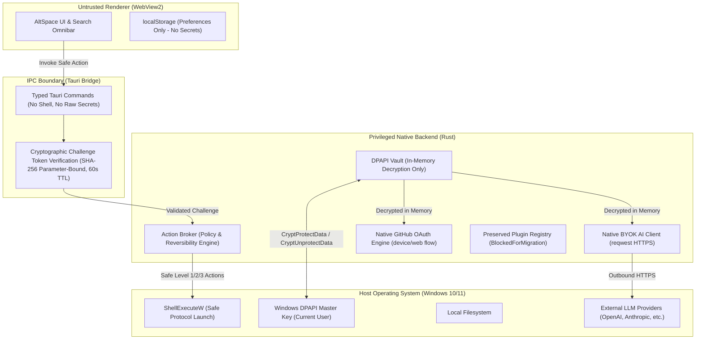

# AltSpace 2.2.0 — Final Security Posture

**Milestone:** `v2.2.0`  
**Classification:** Major Security Hardening & Perimeter Defense  
**Audit Baseline:** [docs/security/audits/phase-0-baseline.md](file:///c:/Users/rohan/.gemini/antigravity/scratch/altspace/docs/security/audits/phase-0-baseline.md)  
**Verification Date:** 2026-10-22

---

## 1. System Architecture & Trust Boundaries

AltSpace 2.2.0 establishes strict, fail-closed boundaries between the untrusted web renderer (WebView2), the privileged native desktop host (Rust/Tauri), and the host Windows operating system.

---

## 2. Hardened Critical Execution Paths

1. **`trigger_app_update` (In-App Binary Execution):**
   - **Pre-Hardening:** Downloaded and executed update binaries directly from untrusted or unverified network locations.
   - **Hardened Status:** Fully disabled. Fails closed with `InAppUpdateDisabled`. Update checking operates in read-only mode, directing users to official release pages.
2. **`execute_shell_command` (Arbitrary Command Execution):**
   - **Pre-Hardening:** Permitted frontend to pass raw shell command strings directly to `cmd.exe` or `powershell.exe`.
   - **Hardened Status:** Completely excised from the Tauri command registration and backend module.
3. **`launch_in_terminal_window` (Terminal Runner):**
   - **Pre-Hardening:** Constructed unquoted command strings passed to interactive terminal emulators.
   - **Hardened Status:** Stripped shell interpolation. Executes strictly via direct argument arrays and sanitized process spawn APIs.
4. **`run_plugin` & `install_plugin` (Community Extensions):**
   - **Pre-Hardening:** Executed arbitrary untrusted community scripts and binaries without sandboxing or cryptographic signatures.
   - **Hardened Status:** Installation and execution completely blocked (`PluginExecutionDisabled`). Existing extensions preserved with `BlockedForMigration` status.
5. **`run_as_admin` (UAC Elevation):**
   - **Pre-Hardening:** Allowed arbitrary paths and scripts to be elevated to administrator status.
   - **Hardened Status:** Enforces strict path normalization, UNC rejection, executable-only extension allowlists, and parameter sanitization.
6. **`broker_execute_action` (Action Broker):**
   - **Pre-Hardening:** Allowed `bypass_approval: true` and contained latent shell and HTTP invocation variants.
   - **Hardened Status:** Bypass routes excised. High-impact actions (Level 2 & 3) require single-use, 60s expiring cryptographic challenge tokens bound to the SHA-256 hash of action parameters.
7. **Secret Handling Across IPC:**
   - **Pre-Hardening:** Decrypted DPAPI credentials and passed them in plaintext across the IPC bridge to WebView.
   - **Hardened Status:** Prohibited plaintext secret transmission across IPC. Secrets are consumed exclusively within Rust native memory.
8. **Client-Side OAuth Storage:**
   - **Pre-Hardening:** Stored GitHub OAuth access tokens in browser `localStorage`.
   - **Hardened Status:** Removed tokens from browser storage. OAuth exchange and authenticated calls operate 100% inside native Rust.

---

## 3. Cryptographic Token Binding Specification

To prevent privilege escalation, token reuse, and parameter tampering, the 2.2.0 Action Broker enforces single-use challenge tokens:

* **Token Format:** Cryptographically random 256-bit token generated via system CSPRNG (`rand::thread_rng()`).
* **Parameter Binding:** Token is bound in-memory to `sha256(canonical_serialized_action_params)`.
* **Single-Use Enforcement:** The token is immediately deleted from the in-memory challenge table upon first evaluation, whether the execution succeeds or fails.
* **Expiration (TTL):** Tokens expire after 60 seconds. Expired tokens are rejected and pruned.
* **Tamper Proofing:** If an attacker attempts to mutate action parameters (e.g. changing file path or target port) using an acquired token, parameter hash mismatch triggers immediate rejection.

---

## 4. Residual Risks & Security Advisory

1. **Host Compromise (User Profile Level):**
   - Windows DPAPI encrypts data using a key derived from the user's Windows login credentials. Malware running under the same user session can access the user's DPAPI store via standard Win32 APIs. AltSpace assumes the host operating system user session is not actively compromised.
2. **Third-Party AI Communication:**
   - BYOK functionality communicates with third-party model APIs via HTTPS. While API keys never cross to the frontend, prompts sent to external providers are subject to the privacy and security policies of those respective providers.
3. **Manual Updates:**
   - Because in-app binary updater extraction is disabled for safety, users must download update installers from the official repository (`codecheesee/altspace`). Users must verify that the installer carries a valid Authenticode signature from `Codecheesee`.
