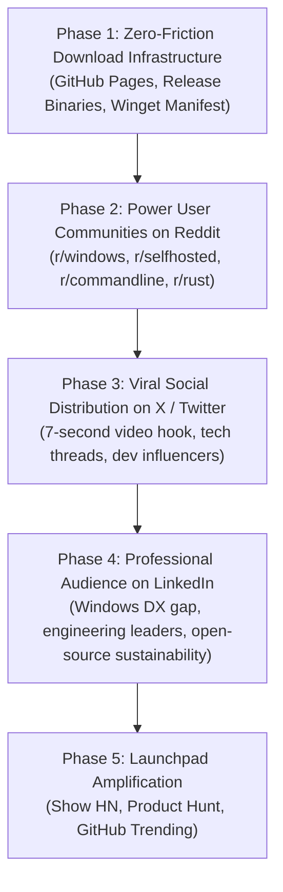
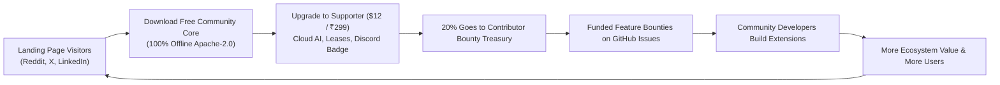

# AltSpace Phased Global Rollout Strategy & Distribution Playbook

This document defines the comprehensive strategy for distributing **AltSpace** worldwide, establishing friction-free download channels, launching across Reddit, X (Twitter), and LinkedIn, and converting users into active community contributors and supporters.

---

## Part 1: Trending Global Windows Distribution Methods Analysis

When distributing desktop software to Windows users worldwide, modern developers expect seamless installation with minimal friction. Below is an evaluation of the industry-standard distribution methods and how AltSpace implements them:

| Distribution Channel | Target Audience | Friction Level | Admin/UAC Required? | SmartScreen Status | Implementation in AltSpace |
| :--- | :--- | :--- | :--- | :--- | :--- |
| **Direct Web Installer (`.exe`)** | 90% of general & developer users | **Zero** (1 click from landing page) | No (installs to `%LOCALAPPDATA%`) | Displays "More info" until certificate reputation builds | `AltSpace-Setup-x64.exe` (3.7 MB NSIS bundle) on landing page and GitHub releases |
| **Windows Package Manager (`winget`)** | Developers, DevOps, Power Users | **Low** (1 terminal command) | No | Automatic verification via Microsoft CI | `winget install codecheesee.altspace` via `distribution/winget/` |
| **PowerShell One-Liner (`irm ... \| iex`)** | Social media discoverers (X, Reddit) | **Instant** (Copy & paste) | No | Script checks SHA256 before running | `irm https://raw.githubusercontent.com/codecheesee/altspace/main/install.ps1 \| iex` |
| **Portable Archive (`.zip`)** | Enterprise locked-down environments, USB | **Zero install** (unzip & run) | No | Extracted locally | `AltSpace-Portable-x64.zip` with embedded `Everything64.dll` |
| **Microsoft Store (MSIX)** | General consumer worldwide reach | **Lowest friction** (trusted store) | No | Trusted by default | Next phase via MSIX packaging workflow |

### The Primary & Best Method for Worldwide Users
The **Primary & Best Method** is a **two-tier frictionless funnel**:
1. **The Web Landing Page with a Big Prominent "Download for Windows" Button**:
   - Downloads `AltSpace-Setup-x64.exe` directly from GitHub Releases.
   - Automatically registers in Windows Start Menu, creates desktop shortcuts, and registers with Windows "Installed Apps" for clean 1-click uninstallation.
   - Users don't need Git, Node.js, Rust, or any developer tools installed.
2. **Terminal Options (Winget & PowerShell)** right below the button for developers who prefer zero-click CLI automation.

---

## Part 2: Landing Page Hosting & Access Architecture

### 1. Where is the Landing Page?
The landing page source code is in the repository at:
`landing/index.html` (with preview image at `landing/og-preview.svg`).

### 2. How to Access It Locally Right Now:
- **Direct in browser**: Double-click `landing/index.html` or open `file:///C:/Users/rohan/.gemini/antigravity/scratch/altspace/landing/index.html` in Chrome/Edge/Firefox.
- **Local Dev Server**:
  ```powershell
  npx serve landing
  # or
  python -m http.server -d landing 3000
  ```

### 3. How Users Worldwide Access It (GitHub Pages Deployment):
AltSpace includes an automated GitHub Pages deployment workflow at `.github/workflows/deploy-landing.yml`.

To activate it:
1. Go to your GitHub repository: `https://github.com/codecheesee/altspace/settings/pages`
2. Under **Build and deployment** &rarr; **Source**, select **GitHub Actions**.
3. Push to `main` (or run **Actions** &rarr; **Deploy Landing Page to GitHub Pages** &rarr; **Run workflow**).
4. The landing page is immediately live worldwide at:
   **`https://codecheesee.github.io/altspace/`**
5. *(Optional)* If you configure a custom domain (e.g. `altspace.dev`), add a `CNAME` file inside `landing/` containing `altspace.dev` and point DNS to GitHub Pages.

---

## Part 3: Phased Multi-Platform Rollout Plan



---

### Phase 1: Infrastructure & Download Foundation (Immediate)
- Deploy landing page to GitHub Pages (`https://codecheesee.github.io/altspace/`).
- Verify live release assets on GitHub:
  - `AltSpace-Setup-x64.exe` (3.7 MB)
  - `AltSpace-Portable-x64.zip` (4.9 MB)
  - `SHA256SUMS.txt`
- Verify Windows SmartScreen advisory is visible on the landing page and README.
- Submit `winget` manifest to `microsoft/winget-pkgs`.

---

### Phase 2: Community Alpha / Power Users on Reddit

**Why Reddit first?** Reddit technical communities provide brutal, authentic feedback on performance, memory usage, and security. Gaining early advocates here establishes grassroots credibility.

#### Target Subreddits & Angles:
1. **r/windows** (Focus: Native lightweight alternative to sluggish Windows Search and heavy Electron tools).
2. **r/selfhosted** (Focus: 100% offline, local Ollama AI via MCP, zero telemetry, local SQLite frecency).
3. **r/commandline** & **r/webdev** (Focus: The instant `:3000` port killer and keyboard-first developer workflow).
4. **r/rust** (Focus: Rust architecture, Tauri v2, Tokio async execution broker).

---

### Phase 3: High-Engagement Viral Launch on X (Twitter)

**Format**: Visual video/GIF + concise high-impact hooks.

#### Hook Asset:
Record a clean 7-second screen recording:
- Terminal throws `Error: listen EADDRINUSE: address already in use :::3000`
- Hit <kbd>Alt + Space</kbd> &rarr; Type `:3000`
- Press <kbd>Enter</kbd> &rarr; Instant termination badge in 3.2ms.
- Dev server restarts instantly.

---

### Phase 4: Professional & Engineering Leadership on LinkedIn

**Why LinkedIn?**
Engineering managers, tech leads, and developers on Windows face massive developer experience friction compared to macOS users who enjoy modern command palettes. Framing AltSpace as a modern solution to Windows developer friction and highlighting open-source sustainability resonates strongly with professional audiences.

---

## Part 4: Pre-Written Launch Copy Ready to Post

### 1. Reddit Post Copy

#### Subreddit: `r/windows`
**Title**:
> *We built AltSpace: a native, open-source Windows command palette in Rust with sub-5ms search, dev port killer, and local AI (<18MB RAM)*

**Post Body**:
```markdown
Hey r/windows,

If you use Windows for daily development and multitasking, you've probably noticed that the built-in Windows Search is often slow, cluttered with web results, and heavy on resources. Meanwhile, popular keyboard command palettes haven't had a true native, lightweight equivalent on Windows.

We built **AltSpace** to fix this. It is a 100% free and open-source desktop command center built with **Rust and Tauri v2**.

### What makes it different:
1. **Insanely Fast & Lightweight**: Idles at ~18MB RAM with sub-5ms cold invocation. No 400MB Electron wrapper.
2. **Instant Dev Port Killer**: Just type `:3000` to inspect listening sockets, identify zombie Node/Vite/Python processes, and kill them with Enter.
3. **Local-First & Private**: Powered by SQLite frecency search and local AI via Ollama (Llama 3.2) with Model Context Protocol (MCP). Zero telemetry, zero cloud tracking.
4. **Windows DPAPI Secret Vault**: Uses Windows DPAPI (`CryptProtectData`) to encrypt API keys with your Windows login credentials—never returned across IPC or stored in plaintext.
5. **Capability Security Broker**: All privileged operations run through single-use parameter-bound approval challenge tokens.
6. **20% Contributor Bounty Treasury**: We set aside 20% of all optional supporter revenue directly into a public GitHub bounty pool to pay developers who build community extensions.

### How to get it:
- 🌐 **Web Installer / Landing Page**: https://codecheesee.github.io/altspace/
- 💻 **Direct Setup Download**: https://github.com/codecheesee/altspace/releases/download/v2.2.0/AltSpace-Setup-x64.exe
- 📦 **PowerShell One-Liner**:
  `irm https://raw.githubusercontent.com/codecheesee/altspace/main/install.ps1 | iex`
- 🛠️ **GitHub Source**: https://github.com/codecheesee/altspace (Apache 2.0)

*Note on Windows SmartScreen: Because we are independent open-source developers without an expensive enterprise certificate, Windows may show "Windows protected your PC". Click "More info" -> "Run anyway". All builds are reproducibly compiled and checksummed on GitHub Actions.*

We'd love to hear your feedback, feature ideas, and test reports!
```

---

#### Subreddit: `r/selfhosted`
**Title**:
> *AltSpace: A private, 100% offline Windows spotlight launcher with local Ollama AI and zero telemetry*

**Post Body**:
```markdown
Hello r/selfhosted,

Most modern productivity palettes and "AI launchers" require constant cloud accounts, upload your clipboard context, and phone home with telemetry.

We built **AltSpace** as an offline-first, privacy-respecting alternative for Windows:

- **100% Local AI**: Connects directly to your local Ollama instance (`http://localhost:11434`) using the Model Context Protocol (MCP). Your queries, clipboard, and file paths never leave your workstation.
- **In-Memory Clipboard History**: Searchable clipboard history with automatic secret masking (API keys, tokens, SSH keys) kept strictly in volatile RAM.
- **Windows DPAPI Vault**: Sensitive credentials are encrypted with Windows Data Protection API using user-login-bound DPAPI keys.
- **Zero Telemetry**: No tracking, no background analytics. You can inspect local diagnostics anytime with `Ctrl + Shift + D`.
- **Open-Core Apache 2.0**: Inspect the Rust codebase, build from source, or download pre-compiled releases.

- GitHub: https://github.com/codecheesee/altspace
- Live Landing Page: https://codecheesee.github.io/altspace/
- Direct Download: https://github.com/codecheesee/altspace/releases/download/v2.2.0/AltSpace-Setup-x64.exe

Happy to answer any architecture or privacy questions!
```

---

### 2. X / Twitter Launch Copy

#### Primary Launch Tweet (With 7-Second Video/GIF attached):
```text
Tired of port collisions and heavy 400MB launchers on Windows?

Introducing AltSpace — a lightning-fast, native command palette built in Rust + Tauri v2.

⚡ Sub-5ms search latency
💀 1-click dev port killer (:3000 + Enter)
🤖 100% local AI via Ollama & MCP
🔐 Windows DPAPI secret vault
🪶 < 18MB RAM idle footprint

100% Free Apache-2.0.

Download for Windows:
https://codecheesee.github.io/altspace/

Or run in PowerShell:
irm https://raw.githubusercontent.com/codecheesee/altspace/main/install.ps1 | iex

🧵 Technical breakdown below 👇
```

#### Thread Tweet 2 (Architecture & Security):
```text
Under the hood:
- Rust backend built on Tauri v2 & Tokio
- Direct Win32 RegisterHotKey hooks for sub-5ms cold invoke
- SQLite frecency ranking engine with logarithmic time decay
- Capability Execution Broker (broker.rs) guarding all shell & filesystem actions
- Zero telemetry, 100% offline-ready

Code: https://github.com/codecheesee/altspace
```

#### Thread Tweet 3 (The 20% Contributor Bounty Treasury):
```text
We believe open source should be sustainable for creators and contributors.

AltSpace operates on a 70/20/10 model:
- 70% Core development
- 20% Community Contributor Bounty Treasury
- 10% Infrastructure

20% of every supporter purchase directly funds cash bounties on GitHub Issues for community extension authors! 💰
```

---

### 3. LinkedIn Post Copy (Professional / Engineering Leadership)

```markdown
If you develop software on Windows, you've likely experienced the "developer experience gap" compared to macOS. 

While macOS developers have enjoyed keyboard-first command centers like Alfred for years, Windows developers have been stuck navigating between Task Manager, fragmented search bars, and electron-based launchers consuming 400MB+ of background RAM.

To close this gap, we engineered **AltSpace** — a high-performance, native command palette built in Rust and Tauri v2.

Here is what we engineered into the architecture:

🔹 **Sub-5ms Execution & 18MB RAM Footprint**: By utilizing native Win32 APIs and Rust instead of an Electron runtime, AltSpace idles at a fraction of the memory overhead of typical desktop utilities.
🔹 **Instant Developer Port Management**: Running into `EADDRINUSE: 3000`? Typing `:3000` identifies the exact process ID (Node, Vite, Python) and terminates it in 3.2ms.
🔹 **Local & Private AI**: With enterprise data privacy in mind, AltSpace integrates with local Ollama models via the Model Context Protocol (MCP). Zero telemetry, zero cloud data leaks.
🔹 **Windows DPAPI Secret Vault**: Credentials and tokens are encrypted at rest using Windows Data Protection API (DPAPI), eliminating plaintext config vulnerabilities.
🔹 **Sustainable Open Source (The 20% Bounty Treasury)**: 20% of all supporter licenses are pooled directly into public GitHub feature bounties to compensate community engineers who build open-source extensions.

AltSpace is open-source under the Apache 2.0 license.

👉 **Landing Page & Direct Download**: https://codecheesee.github.io/altspace/
👉 **GitHub Repository**: https://github.com/codecheesee/altspace

I'd love to hear how fellow engineers and engineering leads manage desktop workflow efficiency on Windows!

#SoftwareEngineering #Rust #WindowsDev #OpenSource #DevTools #Productivity #DeveloperExperience #Tauri
```

---

## Part 5: Commercial Conversion & Bounty Flywheel



### Next Steps for Implementation & Launch:
1. Push git changes to `origin/main` to trigger the automated `deploy-landing.yml` workflow.
2. Verify `https://codecheesee.github.io/altspace/` in your browser.
3. Schedule the Social Media Launch Posts:
   - **Tuesday morning (08:30 EST / 18:00 IST)**: Post to X/Twitter and Reddit (`r/windows`).
   - **Wednesday morning (09:00 EST / 18:30 IST)**: Post to LinkedIn and Reddit (`r/selfhosted`, `r/webdev`).
   - **Thursday**: Monitor GitHub Issues, respond to SmartScreen questions, and post first batch of bounties with Polar.sh / GitHub Sponsors.
