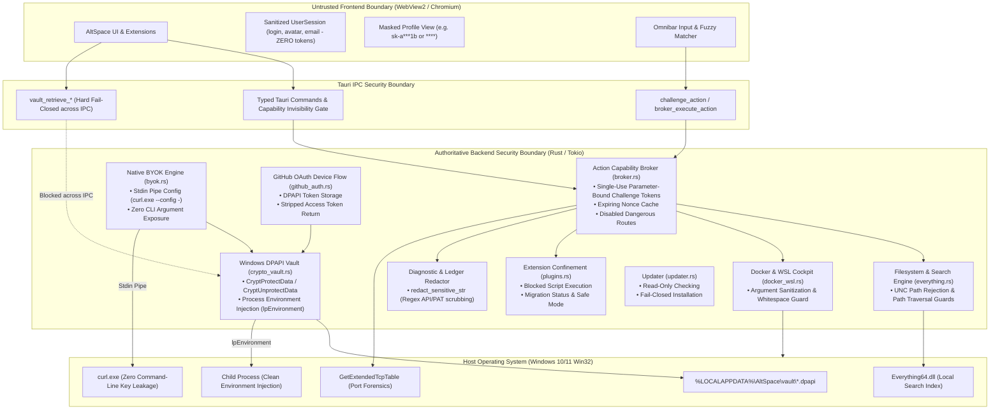

# AltSpace Trust Boundaries & Security Boundary Architecture

> **Document Type:** Canonical Security Architecture Specification  
> **Target OS:** Windows 10 & Windows 11 (x64, arm64)  
> **Enforcement Principle:** The Rust backend is the authoritative security boundary. The Chromium WebView2 renderer is untrusted. Decrypted secrets, OAuth bearer tokens, and unbrokered native execution paths never cross the IPC barrier.

---

## 1. System-Wide Boundary Topology

---

## 2. Definitive Trust Boundary Matrix

| Boundary | Owner | Allowed Data | Forbidden Data | Threats | Tests | Enforcement Point |
| :--- | :--- | :--- | :--- | :--- | :--- | :--- |
| **WebView (Renderer)** | Frontend (React 19 / TS) | Renderable UI state, search queries, sanitized user metadata (`login`, `avatar_url`), masked profile keys (`****`), and transient Omnibar inputs. | Decrypted vault secrets, OAuth access tokens, raw private keys, unmasked API keys, un-sanitized filesystem paths. | DOM XSS, rogue dependency exfiltration, malicious extension DOM inspection, renderer memory dumps. | `frontend/src/lib/authProvider.test.mjs`, `frontend/src/lib/diagnostics.test.mjs` | `authProvider.ts`, `secureVault.ts`, `diagnostics.ts` |
| **IPC (Tauri Transport)** | Tauri v2 Core / `lib.rs` | Strongly typed command payloads, action requests, read-only search queries, challenge requests, masked status responses. | Raw decrypted secret strings, unmasked provider API keys, OAuth `access_token` fields, arbitrary shell commands. | Malicious WebView IPC spoofing, unauthorized command invocation, credential extraction via IPC eavesdropping. | `frontend/src-tauri/src/lib.rs`, `frontend/src/lib/actionBroker.test.mjs` | Command registration handlers in `lib.rs`, Tauri IPC deserializer |
| **Action Broker** | Rust Backend (`broker.rs`) | Strongly-typed `ActionRequest`, parameter-bound single-use challenge tokens, read-only system inspection targets. | Unapproved destructive payloads, mismatched parameters, expired tokens, bypassed authorization tokens. | Confused deputy attacks, parameter mutation between approval and execution, replay attacks, privilege bypass. | `broker::tests::test_single_use_and_replay_rejection`, `broker::tests::test_parameter_mutation_rejection` | `broker::broker_execute_action`, `broker::challenge_action` |
| **Secret Vault** | Rust Backend (`crypto_vault.rs`) | Key names conforming to `^[a-zA-Z0-9_\-\.]{1,64}$`, plaintext strings strictly for DPAPI encryption at rest, masked JSON views for UI. | Plaintext secret returns over IPC, path traversal keys (`..`, `/`, `\`), unencrypted secret persistence to disk. | Credential theft via filesystem copying, memory inspection from WebView, unauthorized secret extraction. | `crypto_vault::tests::test_dpapi_roundtrip`, `crypto_vault::tests::test_has_secret_and_masked_profile` | `crypto_vault::sanitize_key`, `CryptProtectData`, `CryptUnprotectData` |
| **BYOK (AI Engine)** | Rust Backend (`byok.rs`) | User prompts, system prompts, provider names (`anthropic`, `openai`, `deepseek`, etc.), temperature, max tokens. | Provider API keys exposed in CLI arguments (`argv`), external AI connections originating from WebView. | Command-line snooping via Process Explorer or Event 4688, key exposure in browser network inspector. | `byok::tests::test_byok_chat_fails_closed_when_key_missing`, `byok::tests::test_byok_status_returns_only_masked_fingerprint` | `byok::byok_chat_completion`, `curl.exe --config -` piped stdin |
| **OAuth** | Rust Backend (`github_auth.rs`) | GitHub Device Flow client IDs, verification URIs, device codes, sanitized user profiles (`login`, `id`, `name`, `email`). | OAuth `access_token` returned to WebView or saved to `localStorage`. | Browser token theft, cross-site script exfiltration, credential leakage in web storage. | `github_auth::tests::test_github_device_token_poll_sanitization_structure`, `github_auth::tests::test_github_sign_out_clears_dpapi` | `github_auth::github_device_token_poll`, DPAPI store |
| **Extensions** | Rust Backend (`plugins.rs`) | Read-only extension manifests (`plugin.json`), safe extension IDs (`^[a-zA-Z0-9_-]+$`), migration status metadata. | Execution of `.ps1`, `.bat`, `.cmd`, `.py`, `.js` scripts, writing arbitrary files to disk on install. | Unsandboxed Remote Code Execution (RCE), standard user privilege abuse, malicious extension script execution. | `plugins::tests::test_install_plugin_fails_closed_without_writing_files`, `plugins::tests::test_plugin_preservation_and_migration_status` | `plugins::run_plugin` (Blocked), `plugins::install_plugin` (Fails closed) |
| **Updater** | Rust Backend (`updater.rs`) | SemVer version queries, release notes text, changelog lines, read-only release metadata from GitHub API. | Execution of untrusted download installers, unverified binary execution, silent auto-elevation. | Man-in-the-Middle binary substitution, supply chain compromise of update distribution channel. | `updater::tests::test_install_update_fails_closed`, `updater::tests::only_newer_versions_are_updates` | `updater::install_update` (Disabled, fails closed), `updater::check_for_update` (Read-only) |
| **Diagnostics** | Frontend & Backend (`diagnostics.ts`, `broker.rs`) | Sanitized environment metrics, component status flags, redacted log excerpts, masked usernames (`~\`). | Raw API keys (`sk-...`, `ghp_...`), private keys (`BEGIN PRIVATE KEY`), Windows usernames in paths, credentials. | Accidental user leakage when submitting GitHub issues, pasting diagnostics in Discord, log file exfiltration. | `frontend/src/lib/diagnostics.test.mjs`, `broker::tests::test_ledger_and_failure_events_redact_secrets` | `redactSensitiveDiagnostics` (TS), `redact_sensitive_str` (Rust) |
| **Docker / WSL** | Rust Backend (`docker_wsl.rs`) | Alphanumeric container IDs, container names, valid distribution names conforming to safe regex. | Command chaining metacharacters (`;`, `&`, `|`, `` ` ``), flag injection (`--exec`), arbitrary shell wrappers. | Arbitrary container command execution, host breakout via shell metacharacter injection. | `docker_wsl::tests::test_sanitize_identifier_rejects_flags_and_injection`, `docker_wsl::tests::test_sanitize_identifier_valid` | `docker_wsl::sanitize_identifier` |
| **Filesystem & Search** | Rust Backend (`everything.rs`, `actions.rs`) | Absolute local filesystem paths with drive letters (`C:\...`), filename search patterns. | Remote UNC paths (`\\server\share`), directory traversal sequences (`..`), script execution targets. | SMB NTLM hash theft via rogue UNC path opening, arbitrary file overwrite outside target scope. | `actions::tests::test_run_as_admin_rejects_unc`, `actions::tests::test_run_as_admin_rejects_scripts` | `actions::run_as_admin`, `everything::search_everything` |

---

## 3. Threat-Driven Architectural Guarantees

1. **Zero Secret Exposure across IPC**:
   The Tauri command handler rejects any request that attempts to retrieve raw decrypted secrets across the IPC boundary. Plaintext secret material exists only momentarily in Rust process memory when performing native Win32 child process injection (`lpEnvironment`) or when piping credentials to `curl.exe` via stdin.
2. **Replay-Safe, Parameter-Bound Challenges**:
   Every action categorized as Level 2 (`PreviewThenApprove`) or Level 3 (`AlwaysApprove`) requires an approval challenge token generated by Rust. The token is cryptographically random (256-bit hex), expires within 60 seconds, is single-use (consumed upon execution attempt), and is strictly bound to the SHA-256 hash of the exact action parameters. Any parameter mutation causes instantaneous execution rejection.
3. **Piped Stdin Process Creation**:
   Child processes that require API authentication (such as `curl.exe` for AI completions) are invoked exclusively with `--config -` and receive authorization headers via redirected standard input (`stdin.write_all`). This guarantees that sensitive tokens never appear in process argument lists, preventing exposure through `NtQueryInformationProcess`, Process Explorer, or Windows Security Event 4688.
4. **Hard Containment of Extensions**:
   Community script execution (`.ps1`, `.bat`, `.cmd`, `.py`) is completely blocked. Existing extension files and manifests are preserved on disk with explicit `BlockedForMigration` status flags presented to the user. Extension installation fails closed without modifying the filesystem.
5. **Fail-Closed Update Architecture**:
   In-app binary update downloads and executions are disabled. The updater provides strictly read-only version discovery, directing users to official GitHub release packages verified with Authenticode signatures.
